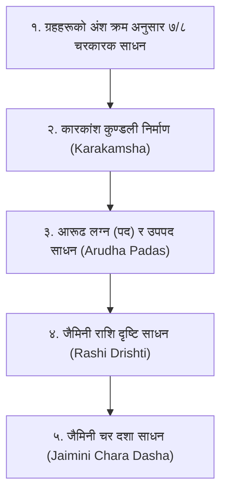
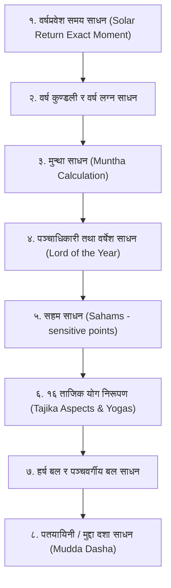

# वेदश्चक्षु जैमिनी: जैमिनी तथा ताजिक पद्धति (Jaimini & Tajika Systems) गणना पद्धति

यो दस्तावेज यस सफ्टवेयर (`SKY VISION 2.0`) भित्र समाविष्ट महर्षि जैमिनीको **जैमिनी सूत्र (Jaimini Sutras)** र निलकण्ठ दैवज्ञको **ताजिक नीलकण्ठी (Tajika Varshaphala)** मा आधारित फलित तथा गणितीय इन्जिनको सम्पूर्ण विवरण हो। यस फोल्डरमा ताजिक गणनासँग सम्बन्धित मूल डेटाबेस [`taajika.mdb`](file:///c:/Users/Hp%20Victus/Documents/aiclass/skyvision/वेदश्चक्षु%20जैमिनी/taajika.mdb) सुरक्षित गरिएको छ।

---

## खण्ड 'क': जैमिनी ज्योतिष पद्धति (Jaimini System)

### १. जैमिनी गणनाको क्रम (Sequence of Calculation)

---

### २. विस्तृत गणितीय प्रक्रिया तथा सूत्रहरू

#### (क) ७ र ८ चरकारक साधन (Chara Karakas)
राहु र केतु बाहेक ७ ग्रहहरू (वा राहु सहित ८ ग्रहहरू) को राशि छोडेर केवल अंश, कला र विकलाको मानलाई घट्दो क्रममा राखिन्छ:
*(राहुको विचार गर्दा राहु सधैँ विलोम हिँड्ने भएकाले $30^\circ - \text{राहुको अंश}$ गरिन्छ)*

1. **आत्मकारक (Atmakaraka - AK):** सबैभन्दा उच्च अंश भएको ग्रह (आत्मा, शरीर, मुख्य नियन्ता)।
2. **अमात्यकारक (Amatyakaraka - AmK):** दोस्रो बढी अंश (कर्म, पेसा, मन्त्रित्व, बुद्धि)।
3. **भ्रातृकारक (Bhratrikaraka - BK):** तेस्रो बढी अंश (दाजुभाइ, पराक्रम, गुरु)।
4. **मातृकारक (Matrikaraka - MK):** चौथो बढी अंश (माता, वाहन, सुख, मन)।
5. **पितृकारक (Pitrikaraka - PiK):** पाँचौँ बढी अंश (८ कारक प्रणालीमा - पिता)।
6. **पुत्रकारक (Putrakaraka - PK):** छैटौँ बढी अंश (सन्तान, विद्या, ज्ञान)।
7. **ज्ञातिकारक (Gnyatikaraka - GK):** सातौँ बढी अंश (शत्रु, रोग, कठिनाइ, बन्धुबान्धव)।
8. **दाराकारक (Darakaraka - DK):** सबैभन्दा न्यूनतम अंश भएको ग्रह (जीवनसाथी, व्यापार)।

#### (ख) कारकांश कुण्डली (Karakamsha Kundali)
* आत्मकारक (AK) ग्रह नवमांश कुण्डली ($D_9$) मा जुन राशिमा अवस्थित हुन्छ, त्यस राशिलाई **कारकांश लग्न** भनिन्छ।
* कारकांश लग्नलाई १ नम्बर भाव मानी जन्म कुण्डलीका ग्रहहरूलाई सोही राशिको स्थितिमा राख्दा **कारकांश कुण्डली** बन्दछ।

#### (ग) आरूढ लग्न (पद) र उपपद साधन
* **आरूढ लग्न (Arudha Lagna - AL):**
  लग्न भावको स्वामी लग्नेश लग्नदेखि जति भाव अगाडि छ, लग्नेशबाट पुनः त्यति नै भाव गन्दा आउने राशि आरूढ पद हो।
  $$\text{AL} = (\text{लग्नेशको स्थान} + (\text{लग्नेशको स्थान} - \text{लग्न स्थान})) \pmod{12}$$
  * *अपवाद नियम:* यदि पद सोही भाव वा सप्तम भावमा परेमा १० भाव अगाडि सारिन्छ।
* **उपपद लग्न (Upapada Lagna - UL):**
  द्वादश (१२औँ) भावको स्वामी द्वादशेशबाट १२औँ भावको दूरी अनुसार निकालिने पद (विवाह र जीवनसाथी विचारका लागि)।

#### (घ) जैमिनी राशि दृष्टि (Sign Aspects)
पाराशरीमा ग्रह दृष्टि हुन्छ भने जैमिनीमा राशिको दृष्टि हुन्छ:
* **चर राशिहरू (मेष, कर्कट, तुला, मकर):** आफ्ना छेउको बाहेक सबै स्थिर राशिहरूलाई हेर्छन्।
* **स्थिर राशिहरू (वृष, सिंह, वृश्चिक, कुम्भ):** आफ्ना छेउको बाहेक सबै चर राशिहरूलाई हेर्छन्।
* **द्विस्वभाव राशिहरू (मिथुन, कन्या, धनु, मीन):** आफू बाहेक अन्य सबै द्विस्वभाव राशिहरूलाई पूर्ण दृष्टिले हेर्छन्।

#### (ङ) जैमिनी चर दशा (Chara Dasha)
यो ग्रह दशा नभई १२ राशिको दशा हो।
* **दशा अवधि वर्ष:**
  प्रत्येक राशिको स्वामी सो राशिदेखि जति भाव टाढा छ, त्यसमा १ घटाउँदा आउने सङ्ख्या सो राशिको दशा वर्ष हुन्छ:
  $$\text{दशा वर्ष} = (\text{राशीशको दूरी}) - 1$$
  *(यदि राशीश आफ्नै राशिमा भए १२ वर्ष; यदि उच्च भए +१ वर्ष, नीच भए -१ वर्ष)*।
* **दशा क्रम:** मेषादि विषम पद राशि भए प्रत्यक्ष (मेष, वृष, मिथुन...) र सम पद भए अप्रत्यक्ष (मीन, कुम्भ, मकर...)।

---

## खण्ड 'ख': ताजिक वर्षफल पद्धति (Tajika Varshaphala)

### १. ताजिक गणनाको क्रम (Sequence of Calculation)

---

### २. विस्तृत गणितीय प्रक्रिया तथा सूत्रहरू

#### (क) वर्षप्रवेश समय (Solar Return Moment)
मानिसको जन्म समयमा सूर्य जुन निरयण राशि, अंश, कला र विकलामा थियो, प्रत्येक वर्ष सूर्य सोही सूक्ष्म विन्दुमा आइपुग्ने सटीक समय (वर्षप्रवेश) निकालिन्छ। सो समयको आधारमा **वर्ष लग्न** र **वर्ष कुण्डली** तयार हुन्छ।

#### (ख) मुन्था साधन (Muntha)
मुन्था वर्ष कुण्डलीको सबैभन्दा संवेदनशील विन्दु हो।
$$\text{मुन्था राशि} = (\text{जन्म लग्न राशि} + \text{विगत पूर्ण वर्ष}) \pmod{12}$$
*(यदि शेष ० आए १२औँ राशि मानिन्छ)*।
* मुन्था ४, ६, ७, ८, १२ भावमा परे अशुभ; १, ९, १०, ११ मा परे अत्यन्त शुभ मानिन्छ।

#### (ग) वर्षेश (Lord of the Year) साधन - ५ अधिकारीहरू
वर्ष कुण्डलीको मुख्य शासक छान्न ५ दाबेदारहरूको परीक्षण गरिन्छ:
1. **मुन्थापति:** मुन्था राशि जुन भावमा पर्छ, त्यसको स्वामी।
2. **जन्म लग्नेश:** मूल जन्म कुण्डलीको लग्नेश।
3. **वर्ष लग्नेश:** वर्ष कुण्डलीको लग्नेश।
4. **त्रिराशीश:** वर्ष लग्नको स्वभाव (चर, स्थिर, द्विस्वभाव) र दिन/रात जन्म अनुसारको स्वामी।
5. **दिन/रात्रिश:** दिवा जन्म भए सूर्य, रात्रि जन्म भए चन्द्रमा।
* **वर्षेश चयन नियम:** यी ५ मध्ये जसले वर्ष लग्नलाई दृष्टि दिन्छ र जसको पञ्चवर्गीय बल सबैभन्दा धेरै हुन्छ, ऊ वर्षेश घोषित हुन्छ।

#### (घ) १६ ताजिक योगहरू (Tajika Yogas)
दुई ग्रहहरू आफ्ना **दीप्तांश** (सूर्य १५°, चन्द्र १२°, मङ्गल ८°, बुध ७°, गुरु ९°, शुक्र ७°, शनि ९°) भित्र रहँदा बन्ने योगहरू:
1. **इत्थशाल (मुथशिल):** तीव्र गतिको ग्रह पछाडि र मन्द गतिको ग्रह अगाडि भई दीप्तांश भित्र दृष्टि हुनु (कार्य सिद्धि)।
2. **ईशराफ (मुसरिफ):** तीव्र ग्रह अगाडि बढी दीप्तांश नाघ्न लाग्नु (कार्य नाश)।
3. **नक्त योग:** दुई ग्रहको दृष्टि नभए पनि बीचको तीव्र ग्रहले प्रकाश स्थानान्तरण गर्नु।
4. **यमया योग:** दुई ग्रहभन्दा बली तेस्रो ग्रहसँग दुवैको सम्बन्ध हुनु।
5. **मणऊ योग:** शुभ योग बन्न लाग्दा पाप ग्रह बीचमा आएर रोक्नु।
6. **कम्बूल योग:** इत्थशाल योगमा चन्द्रमा पनि संलग्न हुनु।
7. **गैर-कम्बूल योग:** चन्द्रमाको बल कमजोर हुनु।
8. **खल्लासार योग:** दुई ग्रह बीच कुनै दृष्टि नहुनु।
9. **रद्द योग:** वक्री वा अस्त भएर योग विफल हुनु।
10. **दुफ्फालि योग:** उच्च ग्रहसँग सम्बन्ध हुनु।
11. **दुत्थकुथीर योग:** नीच ग्रहसँग सम्बन्ध हुनु।
12. **तम्बिर योग:** राशि अन्त्यमा पुग्दा बन्ने योग।
13. **कुत्थ योग:** केन्द्रमा ग्रह हुनु।
14. **दुरूफ योग:** ६, ८, १२ भावमा ग्रह हुनु।
15. **सौम्य योग:** शुभ ग्रहहरूको आपसी सम्बन्ध।
16. **अस्लह योग:** बिग्रेको योग सुधार हुनु।

#### (ङ) सहम साधन (Sahams - ५० संवेदनशील विन्दुहरू)
* **पुण्य सहम:**
  * दिवा जन्म: $\text{पुण्य सहम} = \text{चन्द्र} - \text{सूर्य} + \text{वर्ष लग्न}$
  * रात्रि जन्म: $\text{पुण्य सहम} = \text{सूर्य} - \text{चन्द्र} + \text{वर्ष लग्न}$
* **विद्या सहम:**
  * दिवा जन्म: $\text{विद्या सहम} = \text{सूर्य} - \text{चन्द्र} + \text{वर्ष लग्न}$
  * रात्रि जन्म: $\text{विद्या सहम} = \text{चन्द्र} - \text{सूर्य} + \text{वर्ष लग्न}$
* **यश सहम:** $\text{बृहस्पति} - \text{पुण्य सहम} + \text{वर्ष लग्न}$
* **मित्र सहम:** $\text{बृहस्पति} - \text{पुण्य सहम} + \text{सूर्य}$
*(यदि घटाइने ग्रह र जोड्ने लग्नको बीचमा लग्न पर्छ भने गणनामा ३०° थप जोड्ने नियम हुन्छ)*।

#### (च) हर्ष बल (Harsha Bala - ४ प्रकारका बल)
प्रत्येक ग्रहको अधिकतम २० विश्वोपक बल:
1. प्रथम बल (स्थान): ग्रह आफ्नो तोकिएको विशेष भावमा हुनु (५ बल)।
2. द्वितीय बल (स्वक्षेत्र/उच्च): ग्रह स्वराशि वा उच्चमा हुनु (५ बल)।
3. तृतीय बल (स्त्री/पुरुष): पुरुष ग्रह पुरुष राशिमा, स्त्री ग्रह स्त्री राशिमा हुनु (५ बल)।
4. चतुर्थ बल (दिवा/रात्रि): दिनका ग्रह दिनमा, रातका ग्रह रातमा बली हुनु (५ बल)।

#### (छ) पञ्चवर्गीय बल (Panchavargiya Bala)
ग्रहको १. क्षेत्र बल, २. द्रेष्काण बल, ३. नवमांश बल, ४. हद्दा (Term) बल, र ५. द्वादशांश बलको कुल योग।

#### (ज) पतयायिनी / मुद्दा दशा (Mudda Dasha)
वर्षका ३६५ दिनहरूलाई ९ ग्रहको विंशोत्तरी दशा अनुपातमा बाँडिने वार्षिक दशा:
* सूर्य = १८ दिन, चन्द्र = ३० दिन, मङ्गल = २१ दिन, राहु = ५५ दिन, गुरु = ४९ दिन, शनि = ५८ दिन, बुध = ५२ दिन, केतु = २१ दिन, शुक्र = ६१ दिन (कुल = ३६५ दिन)।
