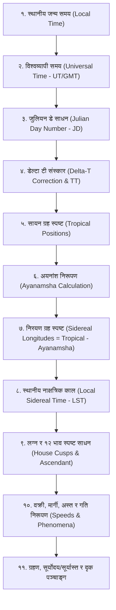

# वेदश्चक्षु दृक्: आधुनिक वैज्ञानिक दृक-गणित (Swiss Ephemeris) गणना पद्धति

यो दस्तावेज यस सफ्टवेयर (`SKY VISION 2.0`) भित्र समाविष्ट **आधुनिक वैज्ञानिक दृक-गणित (Modern Ephemeris / Drik Ganita)** को सम्पूर्ण गणना, क्रम, प्रक्रिया र गणितीय विन्दुहरूको प्रामाणिक विवरण हो। यस फोल्डरमा आधुनिक दृक-गणितका मूल इन्जिनहरू [`swedll32.dll`](file:///c:/Users/Hp%20Victus/Documents/aiclass/skyvision/वेदश्चक्षु%20दृक्/swedll32.dll) र [`astro.dll`](file:///c:/Users/Hp%20Victus/Documents/aiclass/skyvision/वेदश्चक्षु%20दृक्/astro.dll) सुरक्षित गरिएका छन्।

---

## १. सैद्धान्तिक परिचय तथा सफ्टवेयर आर्किटेक्चर

दृक-गणित भनेको आकाशमा टेलिस्कोप वा वेधशालाबाट प्रत्यक्ष देखिने वास्तविक खगोलीय स्थिति (Observed/True Planetary Positions) अनुसार गरिने गणित हो। यस सफ्टवेयरमा स्वीस खगोलविद्हरू (Alois Treindl & Dieter Koch) द्वारा विकसित विश्वप्रसिद्ध **Swiss Ephemeris** इन्जिन प्रयोग गरिएको छ, जसले अमेरिकी अन्तरिक्ष संस्था **NASA JPL (Jet Propulsion Laboratory) DE406** खगोलीय इफेमेरिसलाई आधार मान्दछ।

यसका मुख्य इन्जिन फंक्सनहरू:
* **`swe_julday`:** ग्रेगोरियन/जुलियन क्यालेन्डर मितिलाई जुलियन डे (Julian Day Number) मा रूपान्तरण।
* **`swe_deltat`:** पृथ्वीको दैनिक घूर्णन गतिमा आएको ढिलासुस्ती अनुसार $\Delta T$ (Terrestrial Time - Universal Time) को सूक्ष्म अन्तर साधन।
* **`swe_calc_ut`:** सौर्यमण्डलीय ग्रह, चन्द्रमा र राहु-केतुको सायन (Tropical) भोगांश, अक्षांश (Latitude), दूरी र दैनिक गति साधन।
* **`swe_get_ayanamsa_ut` / `swe_set_sid_mode`:** विभिन्न अयनांशहरूको गणना र निरयण (Sidereal) रूपान्तरण।
* **`swe_houses_ex`:** विभिन्न १२ भाव विभाजन प्रणालीहरू (Placidus, Koch, Whole Sign, Sripati, आदि) बाट लग्न र भाव मध्य/सन्धि साधन।
* **`swe_sol_eclipse_when_loc` & `swe_lun_eclipse_when_loc`:** सूर्य तथा चन्द्रग्रहणको स्पर्श, सम्मीलन, खग्रास/खण्डग्रास, मध्य र मोक्ष कालको स्थानीय समय।

---

## २. दृक-गणित गणनाको वैज्ञानिक क्रम (Sequence of Calculation)

---

## ३. विस्तृत प्रक्रिया तथा गणितीय सूत्रहरू (Mathematical Formulas)

### चरण १: जुलियन डे साधन (Julian Day Number - JD)
कम्प्युटरमा खगोलीय समय गणना गर्न मितिलाई लगातार दिनहरूको सङ्ख्यामा बदलिन्छ:
वर्ष $Y$, महिना $M$, गते $D$, र दशमलव समय $UT$:
यदि $M \le 2$ भए: $Y = Y - 1$, $M = M + 12$
$$A = \lfloor Y / 100 \rfloor, \quad B = 2 - A + \lfloor A / 4 \rfloor$$
$$JD = \lfloor 365.25 (Y + 4716) \rfloor + \lfloor 30.6001 (M + 1) \rfloor + D + \frac{UT}{24} + B - 1524.5$$

---

### चरण २: डेल्टा टी ($\Delta T$) र टेरेस्ट्रियल टाइम (TT)
पृथ्वीको घुम्ने गति चन्द्रमाको ज्वारभाटा आदिका कारण सुस्त हुँदै जान्छ। त्यसैले वास्तविक गतिशील समय (Ephemeris/Terrestrial Time) निकाल्न $\Delta T$ जोडिन्छ:
$$\Delta T = TT - UT$$
$$JD_{TT} = JD_{UT} + \frac{\Delta T}{86400}$$
यस सफ्टवेयरको `swedll32.dll` ले नासाको ऐतिहासिक बहुपदीय (Polynomial) समीकरणबाट सेकेन्डको मिलिसेकेन्डसम्म $\Delta T$ स्वतः जोड्छ।

---

### चरण ३: सायन ग्रह स्पष्टीकरण (Tropical Longitudes)
* **केप्लरको अण्डाकार कक्षीय समीकरण:**
  $$M = E - e \sin E$$
  *(यहाँ $M$ = मध्यम विसङ्गति, $E$ = उत्केन्द्र विसङ्गति, $e$ = उत्केन्द्रता)*
* **ग्रहहरूको आपसी आकर्षण (Perturbations):**
  नासा JPL DE406 सिरिजका फुरियर त्रिकोणमितीय श्रेणीहरू (Chebyshev Polynomials) द्वारा सूर्य, चन्द्र, मङ्गल, बुध, गुरु, शुक्र, शनि, राहु, केतु, युरेनस, नेप्च्युन, प्लूटोको वास्तविक सायन भोगांश ($\lambda_{\text{trop}}$), अक्षांश ($\beta$), र दूरी ($r$) निकालिन्छ।
* **दैनिक गति ($v$):**
  $$v = \frac{d\lambda}{dt}$$
  * यदि $v < 0$ भए $\rightarrow$ ग्रह **वक्री (Retrograde)**
  * यदि $v > v_{\text{औसत}}$ भए $\rightarrow$ ग्रह **अतिचारी (Accelerated)**
  * यदि सूर्यसँग निकट भए $\rightarrow$ ग्रह **अस्त (Combust)**

---

### चरण ४ & ५: अयनांश (Ayanamsha) र निरयण स्पष्ट ग्रह
वसन्त सम्पात (Vernal Equinox) प्रति वर्ष करिब $50.29''$ पश्चिमतर्फ सर्छ। सायन भोगांशबाट अयनांश घटाउँदा वैदिक **निरयण (Sidereal)** भोगांश प्राप्त हुन्छ:
$$\lambda_{\text{sid}} = (\lambda_{\text{trop}} - \text{Ayanamsha}) \pmod{360^\circ}$$

यस सफ्टवेयरमा निम्न प्रमुख अयनांशहरू उपलब्ध छन्:
1. **लाहिडी अयनांश (Chitrapaksha / Lahiri):** नेपाल तथा भारतका आधिकारिक पञ्चाङ्गहरूको आधार (चित्रा नक्षत्रको तारालाई $180^\circ$ मा स्थिर मानिने)।
2. **कृष्णमूर्ति अयनांश (KP Ayanamsha):** केपी नक्षत्र ज्योतिष पद्धतिको आधार।
3. **रमण अयनांश (B.V. Raman):** प्रो. बि.भि. रमणको पद्धति।
4. **सायन पद्धति (Zero Ayanamsha):** पाश्चात्य ज्योतिषका लागि।

---

### चरण ६: स्थानीय नाक्षत्रिक काल (Local Sidereal Time - LST)
* **ग्रीनविच मध्यम नाक्षत्रिक काल (GMST):**
  $$T = \frac{JD_{UT} - 2451545.0}{36525}$$
  $$\theta_{GMST} = 280.46061837 + 360.98564736629 \times (JD_{UT} - 2451545.0) + 0.000387933 T^2 - \frac{T^3}{38710000}$$
* **स्थानीय नाक्षत्रिक काल (LST / RAMC):**
  $$\alpha = (\theta_{GMST} + \text{स्थानीय देशान्तर}) \pmod{360^\circ}$$

---

### चरण ७: स्पष्ट लग्न (Ascendant) र भाव साधन (House Cusps)
* **स्पष्ट सायन लग्न सूत्र:**
  $$\tan \lambda_{\text{Asc}} = \frac{-\cos \alpha}{\sin \alpha \cos \epsilon + \tan \phi \sin \epsilon}$$
  *(यहाँ $\alpha = LST$, $\epsilon = \text{क्रान्तिवृत्तको ढल्काइ } (\approx 23^\circ 26')$, $\phi = \text{स्थानीय अक्षांश})$*
* **निरयण लग्न:**
  $$\text{लग्न स्पष्ट} = (\lambda_{\text{Asc}} - \text{Ayanamsha}) \pmod{360^\circ}$$

* **भाव चक्र प्रणालीहरू (House Systems):**
  1. **Placidus पद्धति:** समयको अर्ध-चाप (Semi-arc) अनुसार भाव विभाजन (केपी पद्धतिमा अनिवार्य)।
  2. **श्रीपति पद्धति (Porphyry/Sripati):** लग्न र दशम भाव (MC) बीचको अन्तरलाई ३ बराबर भागमा बाँडेर भाव मध्य र सन्धि निकाल्ने परम्परागत वैदिक दृक पद्धति।
  3. **Whole Sign (समभाव):** लग्न परेको सम्पूर्ण राशिलाई प्रथम भाव, अर्को राशिलाई दोस्रो भाव मान्ने प्राचीन पद्धति।

---

### चरण ८: दृक पञ्चाङ्ग विन्दुहरू
* **सूक्ष्म तिथि समाप्ति:**
  $$Tithi_{\text{End}} = \frac{(\lambda_{\text{Moon}} - \lambda_{\text{Sun}}) \pmod{360^\circ}}{12^\circ}$$
* **सूक्ष्म नक्षत्र समाप्ति:**
  $$Nak_{\text{End}} = \frac{\lambda_{\text{Moon}}}{13^\circ 20'}$$
* **सूक्ष्म योग समाप्ति:**
  $$Yoga_{\text{End}} = \frac{(\lambda_{\text{Sun}} + \lambda_{\text{Moon}}) \pmod{360^\circ}}{13^\circ 20'}$$
