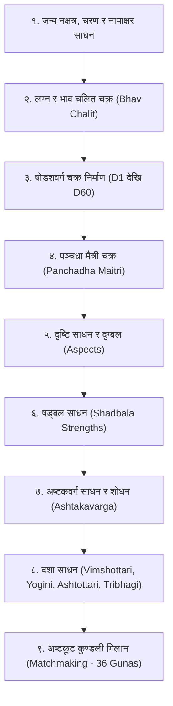

# वेदश्चक्षु पाराशरी: पाराशरी पद्धति (Parashari System) गणना पद्धति

यो दस्तावेज यस सफ्टवेयर (`SKY VISION 2.0`) भित्र समाविष्ट महर्षि पराशरको **बृहत्पाराशर होराशास्त्रम् (BPHS)** मा आधारित पाराशरी फलित तथा गणितीय इन्जिनको सम्पूर्ण विवरण हो। यस फोल्डरमा पाराशरी गणनासँग सम्बन्धित निम्न कम्पोनेन्टहरू सुरक्षित गरिएका छन्:
* **दशा इन्जिन:** [`skyDasha.dll`](file:///c:/Users/Hp%20Victus/Documents/aiclass/skyvision/वेदश्चक्षु%20पाराशरी/skyDasha.dll)
* **फलित तथा कुण्डली डेटाबेसहरू:** [`Phalit.mdb`](file:///c:/Users/Hp%20Victus/Documents/aiclass/skyvision/वेदश्चक्षु%20पाराशरी/Phalit.mdb), [`bibaran1.mdb`](file:///c:/Users/Hp%20Victus/Documents/aiclass/skyvision/वेदश्चक्षु%20पाराशरी/bibaran1.mdb), [`netal.mdb`](file:///c:/Users/Hp%20Victus/Documents/aiclass/skyvision/वेदश्चक्षु%20पाराशरी/netal.mdb), [`jaatak.mdb`](file:///c:/Users/Hp%20Victus/Documents/aiclass/skyvision/वेदश्चक्षु%20पाराशरी/jaatak.mdb)
* **अष्टकूट मिलान तथा स्थान डेटाबेस:** [`gotra.mdb`](file:///c:/Users/Hp%20Victus/Documents/aiclass/skyvision/वेदश्चक्षु%20पाराशरी/gotra.mdb), [`places.mdb`](file:///c:/Users/Hp%20Victus/Documents/aiclass/skyvision/वेदश्चक्षु%20पाराशरी/places.mdb), [`ATLAS.mdb`](file:///c:/Users/Hp%20Victus/Documents/aiclass/skyvision/वेदश्चक्षु%20पाराशरी/ATLAS.mdb)
* **UI तथा सपोर्टिङ कन्ट्रोलहरू:** [`XP.ocx`](file:///c:/Users/Hp%20Victus/Documents/aiclass/skyvision/वेदश्चक्षु%20पाराशरी/XP.ocx), [`pic.ocx`](file:///c:/Users/Hp%20Victus/Documents/aiclass/skyvision/वेदश्चक्षु%20पाराशरी/pic.ocx), [`TAni.ocx`](file:///c:/Users/Hp%20Victus/Documents/aiclass/skyvision/वेदश्चक्षु%20पाराशरी/TAni.ocx)

---

## १. पाराशरी गणनाको शास्त्रीय क्रम (Sequence of Calculation)

---

## २. विस्तृत प्रक्रिया तथा गणितीय सूत्रहरू (Mathematical Formulas)

### चरण १: दशा साधन (Dasha Systems)

#### (क) विंशोत्तरी दशा (१२० वर्ष)
मानव आयु १२० वर्ष मानी २७ नक्षत्रलाई ९ ग्रहमा विभाजन गरिएको छ।
* नक्षत्रको मान = $13^\circ 20' = 800'$ (कला)
* चन्द्रमाको नक्षत्र भित्रको भुक्त कला = $B$
* भोग्य कला = $R = 800' - B$
* **जन्म समयमा महादशाको शेष वर्ष (Balance of Dasha):**
  $$\text{दशा शेष} = \frac{R}{800'} \times \text{सम्बन्धित ग्रहको पूर्ण दशा वर्ष}$$
* **अन्तर्दशा (Antardasha) साधन सूत्र:**
  $$\text{अन्तर्दशा वर्ष} = \frac{\text{महादशा वर्ष} \times \text{अन्तर्दशेश वर्ष}}{120}$$
  $$\text{अन्तर्दशा महिना} = \frac{(\text{अन्तर्दशा वर्षको दशमलव भाग}) \times 12}{1}$$
* **प्रत्यन्तर दशा (Pratyantardasha) सूत्र:**
  $$\text{प्रत्यन्तर वर्ष} = \frac{\text{अन्तर्दशा वर्ष} \times \text{प्रत्यन्तरेश वर्ष}}{120}$$

* **महादशा अवधि तालिका:**
  केतु (७ वर्ष), शुक्र (२० वर्ष), सूर्य (६ वर्ष), चन्द्र (१० वर्ष), मङ्गल (७ वर्ष), राहु (१८ वर्ष), गुरु (१६ वर्ष), शनि (१९ वर्ष), बुध (१७ वर्ष) = कुल १२० वर्ष।

#### (ख) योगिनी दशा (३६ वर्ष)
अश्विनी आदि नक्षत्र गणना अनुसार:
$$\text{योगिनी सङ्ख्या} = \frac{\text{जन्म नक्षत्र सङ्ख्या} + 3}{8} \text{ (बाँकी शेष)}$$
* १ = मङ्गला (१ वर्ष - चन्द्र), २ = पिङ्गला (२ वर्ष - सूर्य), ३ = धान्या (३ वर्ष - गुरु), ४ = भ्रामरी (४ वर्ष - भौम), ५ = भद्रिका (५ वर्ष - बुध), ६ = उल्का (६ वर्ष - शनि), ७ = सिद्धा (७ वर्ष - शुक्र), ८ = सङ्कटा (८ वर्ष - राहु)। कुल = ३६ वर्ष।

#### (ग) अष्टोत्तरी दशा (१०८ वर्ष)
कृष्ण पक्षमा रात्रिको जन्म वा शुक्ल पक्षमा दिवा जन्म भएमा अष्टोत्तरी दशा लागु हुन्छ। (८ ग्रह: सूर्य ६, चन्द्र १५, भौम ८, बुध १७, शनि १०, गुरु १९, राहु १२, शुक्र २१ = १०८ वर्ष)।

#### (घ) त्रिभागी दशा (८० वर्ष)
विंशोत्तरी नक्षत्र मानलाई ३ भाग ($4^\circ 26' 40''$) गरी मानव आयु ८० वर्ष मानी निकालिने दशा।

---

### चरण २: षड्बल साधन (Shadbala - ६ प्रकारका बलहरू)
षड्बलको मापन **रूप (Rupa)** वा **षष्ट्यंश (Shashtiamsas)** मा गरिन्छ (१ रूप = ६० षष्ट्यंश):

1. **स्थान बल (Sthana Bala):**
   * उच्च बल: $\text{उच्च बल} = \frac{|\text{ग्रह स्पष्ट} - \text{नीच स्थान}|}{3}$ (अधिकतम ६० षष्ट्यंश)
   * सप्तवर्गीज बल (मूलत्रिकोण, स्वक्षेत्र, मित्र, शत्रु वर्ग अनुसार)
   * ओज-युग्म (विषम-सम) राशि बल
   * केन्द्रादि बल (केन्द्र = ६०, पणफर = ३०, आपोक्लिम = १५)
   * द्रेष्काण बल
2. **दिग्बल (Dig Bala):**
   * प्रथम भाव (पूर्व): बुध र गुरु (६० षष्ट्यंश)
   * चतुर्थ भाव (उत्तर): चन्द्र र शुक्र (६० षष्ट्यंश)
   * सप्तम भाव (पश्चिम): शनि (६० षष्ट्यंश)
   * दशम भाव (दक्षिण): सूर्य र मङ्गल (६० षष्ट्यंश)
   * अन्य स्थानमा दिग्बल: $\text{दिग्बल} = \frac{180^\circ - |\text{ग्रह} - \text{शून्य दिग्बल विन्दु}|}{3}$
3. **काल बल (Kaala Bala):**
   * नतोन्नति बल (दिवा/रात्रि जन्म अनुसार)
   * पक्ष बल (शुक्ल पक्षमा शुभ ग्रह, कृष्ण पक्षमा पाप ग्रह बली)
   * त्रिभाग बल (दिन र रातलाई ३/३ भाग गर्दाको अधिपति बल)
   * वर्षेश, मासेश, दिनेश र होरेश बल
   * अयन बल (उत्तरायणमा सूर्य/गुरु/शुक्र/भौम, दक्षिणायनमा चन्द्र/शनि)
   * युद्ध बल (ग्रह युद्धमा विजयी ग्रहलाई प्राप्त हुने बल)
4. **चेष्टा बल (Chesta Bala):**
   * ग्रहको वक्र, अतिचारी, मन्द, सम गतिको अनुपातबाट चेष्टा केन्द्र निकाली साधन गरिने बल।
5. **नैसर्गिक बल (Naisargika Bala):**
   * सधैँ स्थिर रहने बल: सूर्य (६०), चन्द्र (५१.४३), शुक्र (४२.८६), गुरु (३४.२९), बुध (२५.७१), मङ्गल (१७.१४), शनि (८.५७ षष्ट्यंश)।
6. **दृग्बल (Drik Bala):**
   * कुण्डलीका अन्य ग्रहहरूले सो ग्रहमाथि पारेको शुभ र अशुभ दृष्टिको बीजगणितीय योग।

---

### चरण ३: अष्टकवर्ग साधन (Ashtakavarga System)
* **प्रस्ताराष्टकवर्ग:** लग्न सहित ८ घटकहरूले आ-आफ्नो स्थानबाट शुभ स्थानमा बिन्दु (१) र अशुभमा रेखा (०) दिन्छन्।
* **भिन्नाष्टकवर्ग:** प्रत्येक ग्रहको १२ राशिमा आएको कुल शुभ बिन्दु (सूर्य ४८, चन्द्र ४९, मङ्गल ३९, बुध ५४, गुरु ५६, शुक्र ५२, शनि ३९ कुल ३३७ बिन्दु)।
* **सामुदायिकाष्टकवर्ग:** १२ वटै भावमा सबै ग्रहका बिन्दुहरूको संयुक्त जोड (२८ भन्दा बढी भए शुभ, कम भए कमजोर)।
* **शोधन प्रक्रिया:**
  1. **त्रिकोण शोधन:** त्रिकोण राशिहरू (मेष-सिंह-धनु, वृष-कन्या-मकर, मिथुन-तुला-कुम्भ, कर्कट-वृश्चिक-मीन) बीच तुलना गरी सबैभन्दा न्यूनतम मान बराबर तीनै राशिबाट घटाइन्छ।
  2. **एकाधिपत्य शोधन:** सूर्य र चन्द्र बाहेक एकै ग्रहका दुई राशिहरू (जस्तै मङ्गलको मेष र वृश्चिक) मा ग्रह भए/नभएको आधारमा नियम अनुसार थप घटाइन्छ।
  3. **पिण्ड साधन:** शोधित बिन्दुलाई राशिगुणक र ग्रहगुणकले गुणन गरी **राशिपिण्ड**, **ग्रहपिण्ड** र **शोधपिण्ड** निकालिन्छ।

---

### चरण ४: षोडशवर्ग चक्र निर्माण (Sixteen Divisional Charts)
* $D_1$ लग्न कुण्डली ($30^\circ$)
* $D_2$ होरा कुण्डली ($15^\circ$ - धन विचार)
* $D_3$ द्रेष्काण ($10^\circ$ - भ्रातृ/पराक्रम)
* $D_4$ चतुर्थांश ($7^\circ 30'$ - भाग्य/सम्पत्ति)
* $D_7$ सप्तमांश ($4^\circ 17' 8.5''$ - सन्तान)
* $D_9$ नवमांश ($3^\circ 20'$ - दाम्पत्य जीवन, भाग्य, मुख्य शक्ति)
* $D_{10}$ दशमांश ($3^\circ$ - वृत्ति/कर्म/प्रतिष्ठा)
* $D_{12}$ द्वादशांश ($2^\circ 30'$ - माता-पिता)
* $D_{16}$ षोडशांश ($1^\circ 52' 30''$ - वाहन/सुख)
* $D_{20}$ विंशांश ($1^\circ 30'$ - आध्यात्मिक साधना)
* $D_{24}$ चतुर्विंशांश ($1^\circ 15'$ - विद्या/ज्ञान)
* $D_{27}$ सप्तविंशांश ($1^\circ 6' 40''$ - बल/सहनशीलता)
* $D_{30}$ त्रिंशांश ($1^\circ$ - अरिष्ट/दोष)
* $D_{40}$ खवेदांश ($45'$ - शुभ-अशुभ फल)
* $D_{45}$ अक्षवेदांश ($40'$ - सम्पूर्ण चरित्र)
* $D_{60}$ षष्ट्यंश ($30'$ - सूक्ष्म कर्मफल/पूर्वजन्म)

---

### चरण ५: अष्टकूट कुण्डली मिलान (Matchmaking - ३६ गुण)
वर र वधूको जन्म नक्षत्र तथा चन्द्र राशि अनुसार:
1. **वर्ण (१ गुण):** ब्राह्मण, क्षत्रिय, वैश्य, शूद्र
2. **वश्य (२ गुण):** चतुष्पद, द्विपद, जलचर, वनचर, कीट
3. **तारा (३ गुण):** जन्म, सम्पत्, विपत्, क्षेम, प्रत्यरि, साधक, वध, मित्र, अतिमित्र
4. **योनि (४ गुण):** १४ पशुपक्षी योनि (परस्पर वैरत्व विचार)
5. **ग्रहमैत्री (५ गुण):** चन्द्र राशीशहरूको आपसी मित्रता
6. **गण (६ गुण):** देव, मनुष्य, राक्षस गण
7. **भकूट (७ गुण):** षडाष्टक (६/८), नवपञ्चम (५/९), द्विर्द्वादश (२/१२) दोष विचार
8. **नाडी (८ गुण):** आदि, मध्य, अन्त्य नाडी (एउटै नाडी भए ८ मा ० अङ्क - नाडी दोष)
* **कुल योग = ३६ गुण** (१८ भन्दा माथि ग्राह्य, २४ भन्दा माथि उत्तम)।
